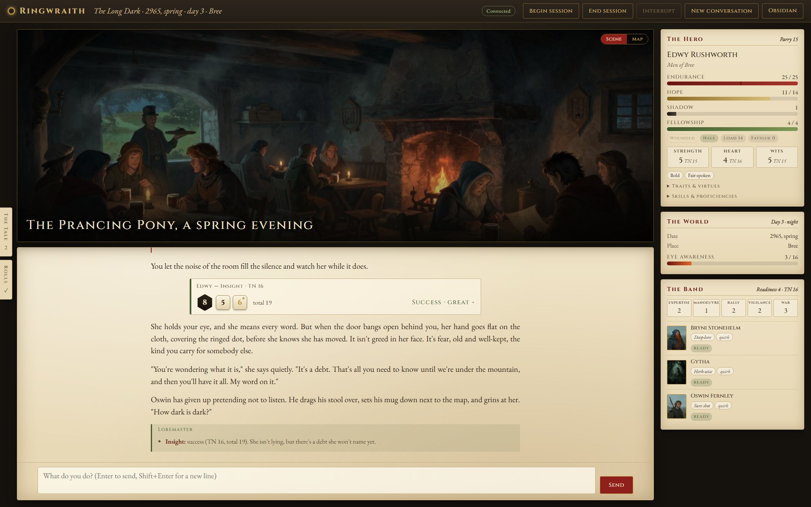
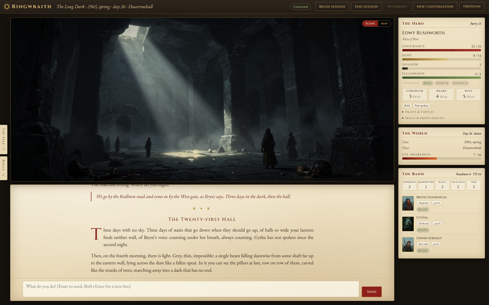
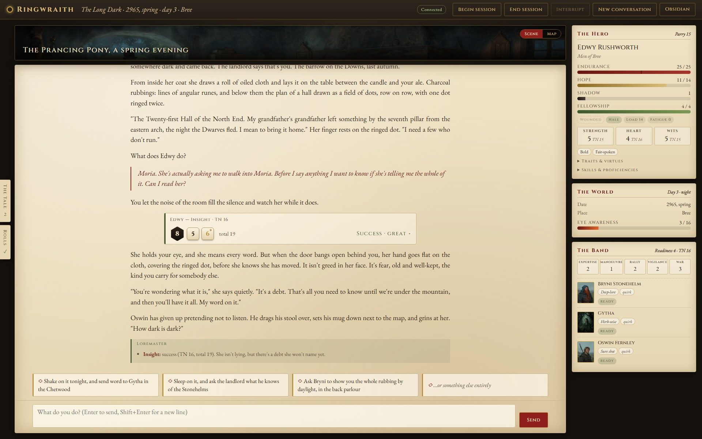
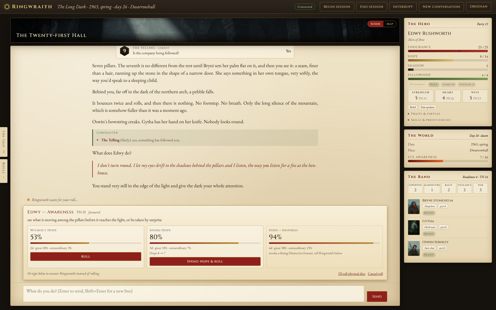
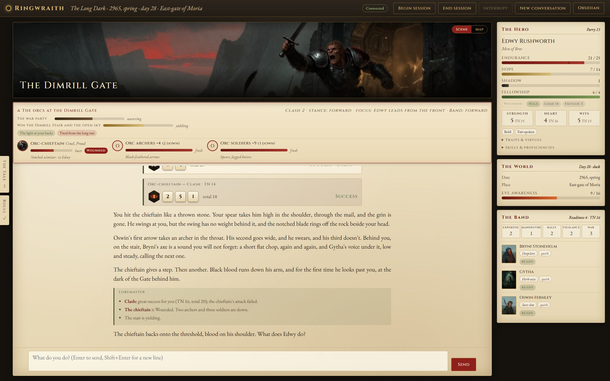
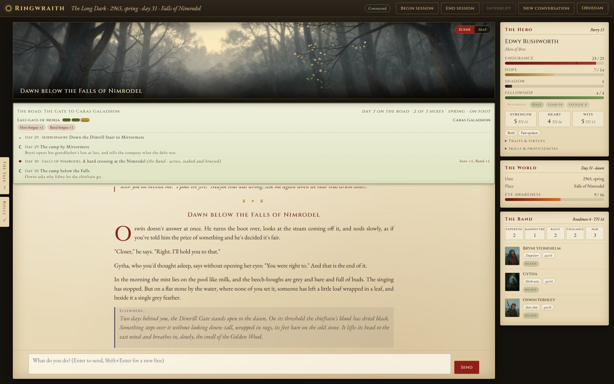
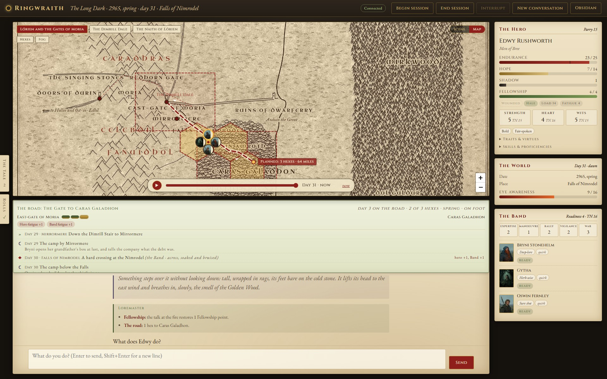

<div align="center">


**A solo Loremaster for The One Ring, 2nd edition.**
Claude runs the world, the oracles and the bookkeeping while you play your hero, at a table in
your browser with painted scenes, a dice tray, maps and a campaign vault in Obsidian.

[](LICENSE)




</div>

> This repository contains **only code and prompts**. You need your own copies of the books: Ringwraith
> builds its library from your PDFs, and everything made from them stays on your machine.

## Screenshots

| | |
|---|---|
|  |  |
| **Take in the view:** click the painting to see all of it | **Paths:** a few ways forward as cards, or type anything else |
|  |  |
| **The dice tray:** the odds with and without Hope, before you choose | **Battles:** the Fight panel shows what the hero can see |
|  |  |
| **Journeys:** each day, camp and event on the road, and a cutaway | **The map:** the road so far, who is where, the planned route |

## Features

- **A Loremaster that follows the rules.** Ringwraith runs journeys, councils, combat, Band battles,
  missions and the Fellowship Phase by the Core Rules, Strider Mode and the Moria solo rules.
- **Real dice, or yours.** Every roll comes to a tray that shows the odds and lets you decide on Hope. Roll
  there, or roll physical dice and enter them. Oracles and lore tables are rolled in the open.
- **Panels for what matters now.** Live hero and Band sheets, a Fight panel during combat and battles, and a
  Journey panel with every march, event and camp on the road, and the fatigue it cost.
- **Painted scenes.** Scenes, portraits and adversaries are painted on your own GPU, in the style of the
  modern books. Nothing leaves your machine.
- **A map of the tale.** Region maps with the places you've seen, everyone's whereabouts, the travel log day
  by day, the hex grid and a fog of unknown lands.
- **Story first.** Ringwraith tells outcomes as story and keeps mechanics in a short Loremaster note. With
  `cutaways: on` in your Compass, it now and then shows a scene the hero can't see, to raise the tension.
- **A campaign you can read.** Each campaign is an Obsidian vault: session chronicles, people, places,
  threads, journeys and maps, with Ringwraith's own secrets kept out of sight.

## What you need

| | |
|---|---|
| [Claude Code](https://claude.com/claude-code) | Installed and logged in on this computer. Ringwraith plays through your Claude login |
| [Python 3.12+](https://www.python.org/downloads/) | |
| The books | Your PDFs of The One Ring 2e. To play: the **Core Rules**, **Strider Mode**, **Moria** and the **Loremaster's Screen**. Other books add places, adventures and tables |
| [Lemonade](https://lemonade-server.ai) (optional) | A local image server for the paintings. Needs a GPU, about 12 GB of video memory |
| [Obsidian](https://obsidian.md) (optional) | To read your campaign between sessions |
| Chrome or Edge | To play at the table |

## Setting up

**1. Install.** Install [Claude Code](https://claude.com/claude-code) and log in (run `claude` once).
Then, in a terminal, in the folder where you want Ringwraith:

```sh
git clone <this repository's URL> ringwraith
cd ringwraith
python -m venv .venv
.venv/Scripts/activate                 # on Linux and macOS: source .venv/bin/activate
pip install -e .
copy ringwraith.example.toml ringwraith.toml    # cp on Linux and macOS
```

Open `ringwraith.toml` and set `vaults` to the folder where your campaigns should live. Every
`ringwraith` command below runs in this terminal, with the `.venv` activated.

**2. Add your books.** Put your PDFs in the `References` folder and check that they are recognised:

```sh
ringwraith doctor
```

They are recognised by the words in their file names, so they can be called anything that names the book
("Core Rules", "Strider Mode", "Moria"…). If one isn't, name it in `ringwraith.toml`; `doctor` shows how.

**3. Build the library.** Ringwraith doesn't read the PDFs during play. It reads a library of the rules,
tables, places and people, distilled from your books by Claude. This is done once, with Claude Code in the
`ringwraith` folder:

```sh
claude
```

and then, in Claude Code:

```
/distill
```

It extracts your books, then writes the library in `lore/` part by part, checking every table against the
page it came from. It's a long job, so it keeps its progress in `lore/DISTILL.md`. When a session runs out,
start a new one and type `/distill` again to continue where it stopped. You need only the rules (the first
five parts) to play. Places, adventures and the map of Eriador can wait until you want them.

Where the books leave a rule open, Claude writes its own ruling and marks it. At the end it goes through these
with you, and through the draft rules for leading a Band outside Moria if you play that way.

**4. Paintings (optional).** Install [Lemonade](https://lemonade-server.ai) and an image model as described
in [docs/art-models.md](docs/art-models.md), and leave it running while you play. `ringwraith doctor` shows
whether it is found. Without it, Ringwraith plays without pictures.

## Playing

```sh
ringwraith new bree-2965 --name "Shadows on the Greenway"   # a new campaign
ringwraith serve                                            # the table, at http://127.0.0.1:2965
```

In a new campaign, type `/session-zero` at the table: Ringwraith builds your hero and your Compass with
you, and sets the opening scene. After that, press **Begin session** to pick up where you left off and
**End session** when you stop; Ringwraith writes the session down and keeps the campaign in order.

Just say what your hero does. Ringwraith asks for rolls when the rules call for them. You can also type
`/paths` when you're unsure what to do next, `/hooks` for new adventures, and `/oracle` to ask the world a
question.

The table plays one campaign at a time. To play another, stop the table, switch, and start it again:

```sh
ringwraith campaigns                 # your campaigns (* = the active one)
ringwraith switch <name>
ringwraith easy on|off               # easy mode: easier fights
ringwraith dice-mode auto|manual     # dice rolled for you, or your own dice
ringwraith settings art.enabled false   # no paintings in this campaign
```

Each campaign is a folder in your `vaults` folder. Open it as a vault in Obsidian to read the tale so far:
the sessions, the people and places you've met, the threads still open and the maps.

The table is for one player on this computer. It listens only on `127.0.0.1` and refuses other web pages.

## More

- [docs/development.md](docs/development.md): how Ringwraith is built, testing, and the screenshots
- [docs/roadmap.md](docs/roadmap.md): what works and what's next

## License

Ringwraith is released under the [MIT License](LICENSE). The bundled libraries in
`tools/ringwraith/web/static/vendor` keep their own licenses (see the README there).

Ringwraith is a fan project, not affiliated with Free League Publishing, Sophisticated Games or the Tolkien
Estate. The One Ring, Middle-earth and the names in it belong to their owners. You need the books to play.
